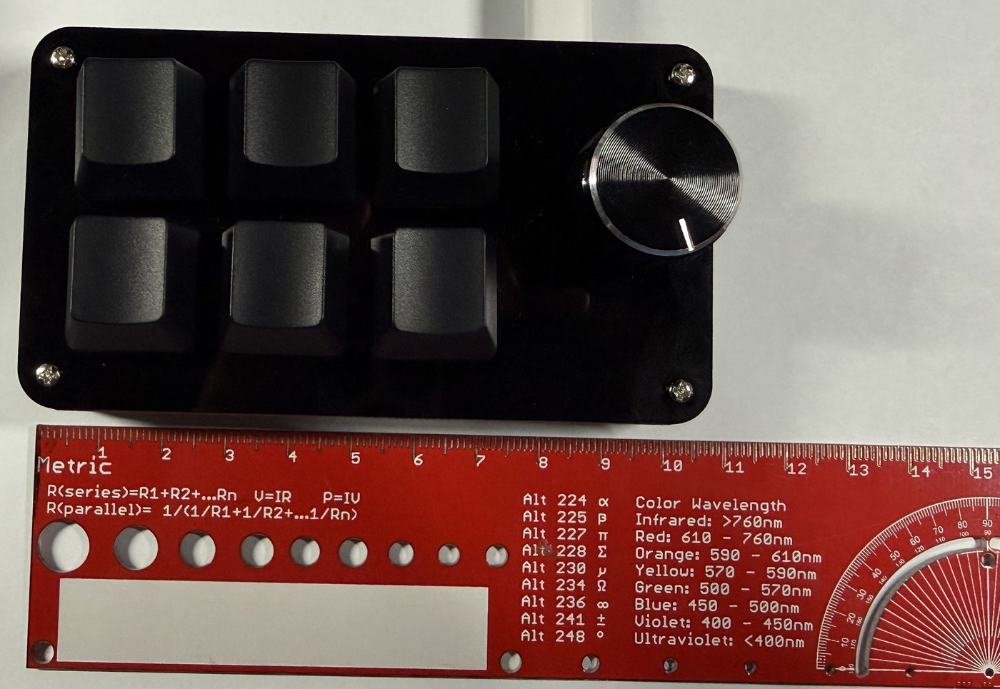
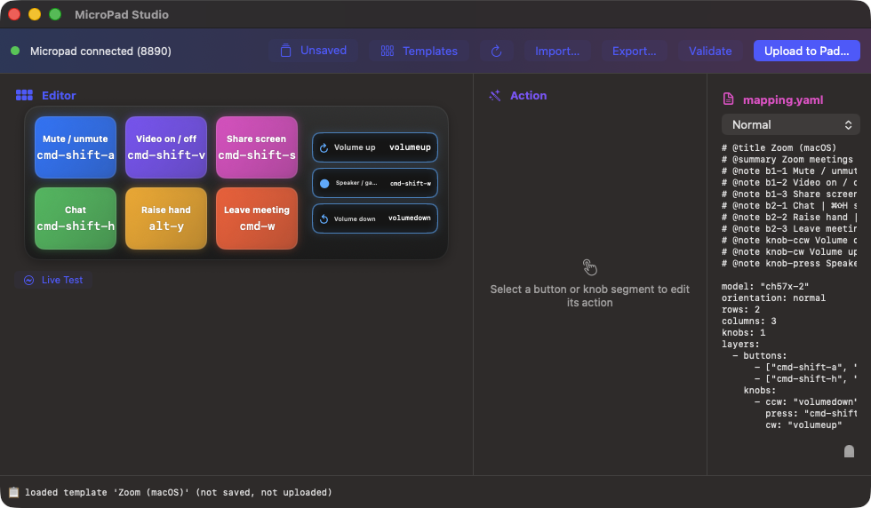
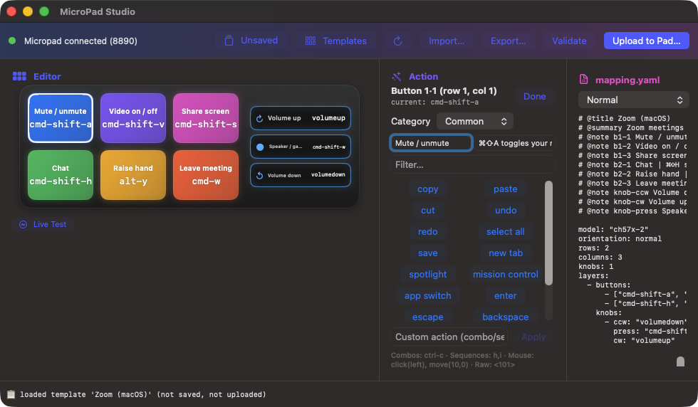
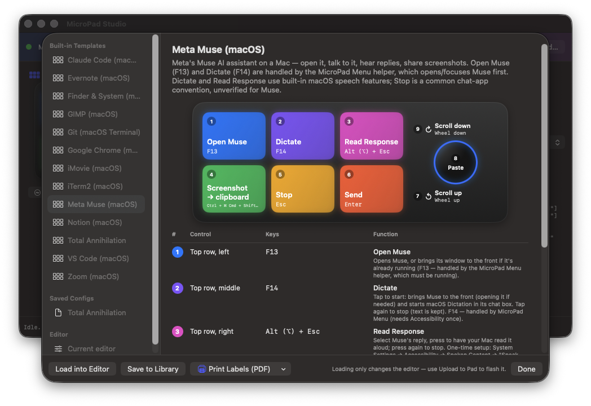
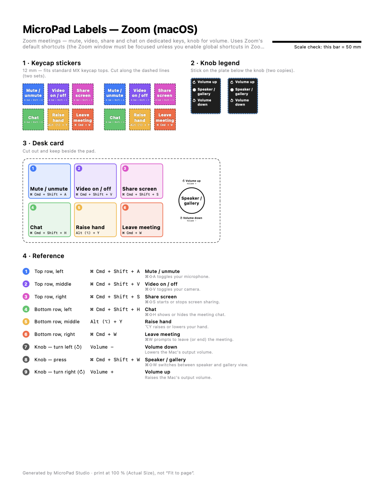
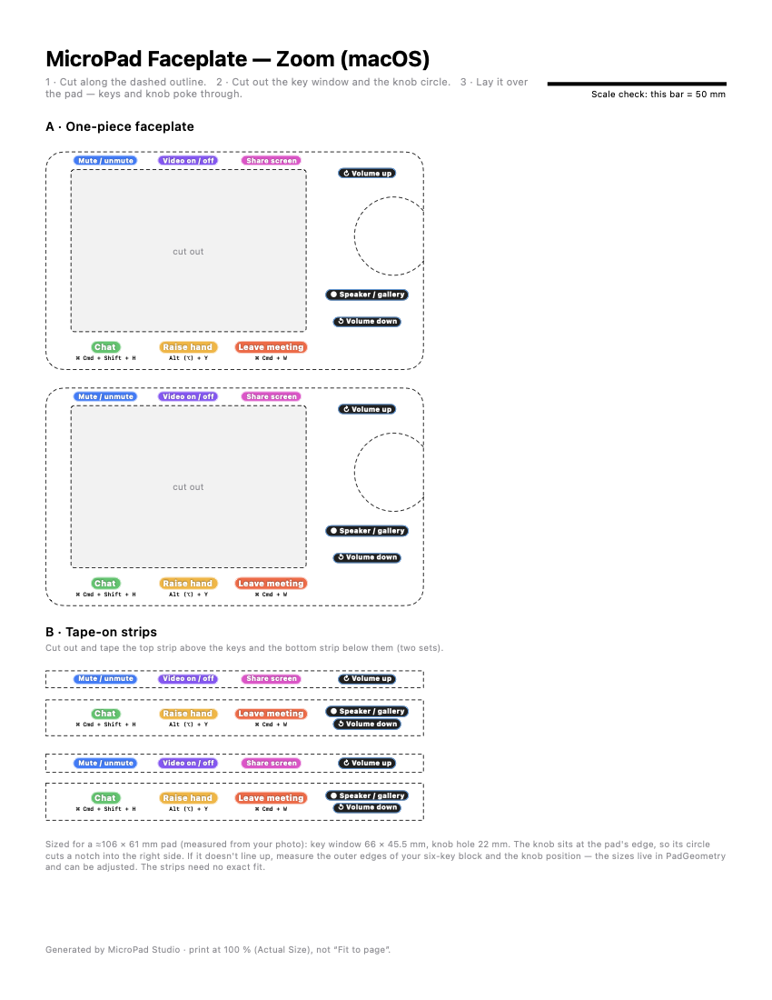
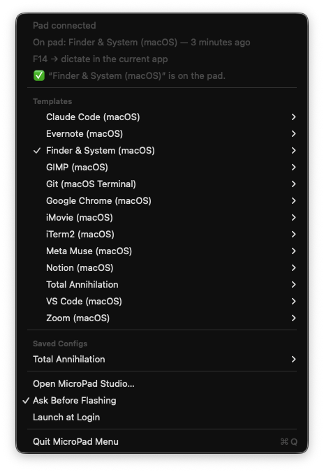

# ch57xx-micropad — MicroPad Studio

Mac tools for a **3×2 + 1 knob CH57x macro pad** (USB `1189:8890`, standard MX
keycaps, no layer button). Built around
[ch57x-keyboard-tool](https://github.com/kriomant/ch57x-keyboard-tool) v1.7.0,
which is bundled — nothing else to install.

Two apps:

| App | What it's for |
|---|---|
| **MicroPad Studio** | Edit what each key and the knob do, browse templates, save/import/export configs, flash the pad, live-test key presses, print labels. |
| **MicroPad Menu** | Menu bar helper: flash any template or saved config in two clicks, and power the *Open app* / *Dictate* keys. |

## The hardware



This is the pad the apps were built and tested on — a generic "6-key + 1-knob" mini macro
keyboard, often sold without a brand name:

- **6 keys in a 3×2 grid** with standard **MX-style** switches and keycaps, plus **one rotary knob**
  (turn left, press, turn right) on the right.
- Black acrylic case, about **106 × 61 mm**, USB-C cable.
- No layer button (so one layer only).
- Shows up on USB as vendor/product **`1189:8890`** — check with
  `ioreg -p IOUSB -l -w0 | grep -A2 '"idVendor" = 4489'` (4489 = 0x1189).

Other CH57x pads that ch57x-keyboard-tool supports (`1189:8840`, `1189:8842`, different key
counts) may work for flashing, but the editor, guide and printable labels assume this 3×2 + 1
layout.

## Installation

### Requirements
- A Mac with **macOS 14 Sonoma or later** (Apple silicon or Intel).
- The pad connected with a **USB data cable** (it can't be programmed over Bluetooth).
- To build: **Xcode** (full app, from the App Store) and **[XcodeGen](https://github.com/yonaskolb/XcodeGen)**
  (`brew install xcodegen`). Nothing else — `ch57x-keyboard-tool` is bundled.

### 1. Build the apps
```bash
git clone https://github.com/jeaimehp/ch57x-macropad-macos-utility.git
cd ch57x-macropad-macos-utility
scripts/setup_signing.sh      # once per Mac: creates a local code-signing identity
scripts/package_dist.sh       # builds both apps → dist/MicroPadStudio.app, dist/MicroPad Menu.app
```
`setup_signing.sh` makes a self-signed certificate in its own keychain, so macOS keeps the app's
permissions when you rebuild later. Always rebuild with `package_dist.sh`.

### 2. Install
```bash
cp -R dist/MicroPadStudio.app "dist/MicroPad Menu.app" /Applications/
open /Applications/MicroPadStudio.app
open "/Applications/MicroPad Menu.app"
```
Apps you build yourself open normally. If you copy them to another Mac (e.g. via the zip in
`dist/`), macOS will say the developer can't be verified: right-click the app → **Open** → **Open**,
or allow it in **System Settings → Privacy & Security → Open Anyway**.

### 3. Grant permissions (only when you use the feature)
| Feature | Permission | Where |
|---|---|---|
| Live Test (Studio) | **Input Monitoring** for MicroPad Studio | System Settings → Privacy & Security → Input Monitoring |
| Dictate keys (Menu) | **Accessibility** for MicroPad Menu | System Settings → Privacy & Security → Accessibility |
| Dictation itself | Dictation turned on | System Settings → Keyboard → Dictation |
| Finder template: Focus / Terminal Here | Two keyboard shortcuts | `bash scripts/setup_finder_shortcuts.sh` (backs up your settings) or set them by hand |

### 4. Keep the menu bar helper running
Open **MicroPad Menu** (grid icon in the menu bar) → turn on **Launch at Login**. The *Open app*
and *Dictate* keys only work while it's running.

### 5. Flash your first template
- **Studio:** **Templates** → pick one → **Load into Editor** → **Upload to Pad…**
- **Menu bar:** MicroPad Menu → *template* → **Flash to Pad**

Uploading takes about a minute — don't unplug the pad. It replaces whatever the pad held (the pad
can't be read back), but templates and saved configs are kept so you can always flash them again.

### Uninstall
Delete both apps from `/Applications`. Saved configs live in
`~/Library/Application Support/MicroPadStudio/`; the signing identity in
`~/Library/Keychains/micropad-signing.keychain-db` and `~/.config/micropad-studio/`.

## Features

### MicroPad Studio — the editor



- **Status bar** — green dot when the pad is plugged in; the config name (or *Unsaved*) opens the
  **config library** (save / save as / duplicate / rename / delete).
- **Toolbar** — **Templates** guide, ↻ re-scan for the pad, **Import… / Export…** `.yaml`
  (you can also drag a `.yaml` onto the window), **Validate**, **Upload to Pad…**.
- **Editor** — the pad as rainbow keycaps (same colours as the icon, guide and printed labels) plus
  the knob's three actions: turn right, press, turn left. Each key shows its function name and
  keystroke. Click one to edit it.
- **Live Test** — press keys or turn the knob and the matching control lights up (needs
  Input Monitoring once).
- **mapping.yaml** — live preview of exactly what will be sent to the pad.
- Bottom line — result of the last action (validated, uploaded, saved, errors).



- **Action inspector** (after clicking a control) — pick from *Common* (copy, paste, Spotlight…),
  *Keys*, *Media*, *Mouse* or *Advanced*, filter by name, or type a custom action: combos (`ctrl-c`),
  sequences of up to 5 keys (`g,s,t,enter`), mouse (`click`, `wheel(-5)`) or raw codes (`<72>`).
- **Function / Explanation** fields — name the control and describe it; shown on the keycap, in
  the guide and on printed labels.
- **Validate** and **Upload** refuse things the pad can't play (see *Pad limits*). Upload asks for
  confirmation, takes about a minute and keeps the window responsive.

### Templates guide



- Sidebar: **Built-in Templates**, your **Saved Configs** and the **Current editor**.
- Each entry shows a picture of the pad with every function on its key, the knob actions, and a
  numbered list: position, keystroke, function and a plain-English explanation (generated
  automatically when a config has no notes).
- **Load into Editor**, **Save to Library**, and **Print Labels (PDF)**. Loading only changes the
  editor; use **Upload to Pad** to flash it.

### Printable labels

| Keycap stickers, knob legend & desk card | Faceplate overlay & tape-on strips |
|---|---|
|  |  |

True-size US Letter PDFs (print at **100 % / Actual Size**; check the 50 mm scale bar):
- **Keycap stickers** — 12 mm, fit standard MX keycap tops; two sets, in each key's colour.
- **Knob legend** — 17×20 mm, sits on the plate below the knob.
- **Desk card** and **reference table** — keep beside the pad.
- **Faceplate overlay** — pad-shaped card with one window around all six keys and a hole for the
  knob; labels print above and below the keys. Cut it out and lay it over the pad.
- **Tape-on strips** — the same labels as two thin strips to tape above and below the keys.

Sizes come from a ruler photo of the pad (`PadGeometry` in `FaceplateSheetView.swift`).

### MicroPad Menu — menu bar helper



- **Status** — pad connected, **what's on the pad** (✓ in the list) and when it was flashed,
  active app keys, and the result of the last flash.
- **Templates / Saved Configs** — each is a submenu with **Flash to Pad** and a cheat sheet of its
  controls. Flashing asks first (turn off with *Ask Before Flashing* or "Don't ask again").
- **Open MicroPad Studio…**, **Launch at Login**, **Quit**.
- **App keys** — a template can make the spare keys F13–F20 open an app or start dictation; only
  the config currently on the pad is active:
  - **Open Muse** — opens Meta Muse or brings it to the front.
  - **Dictate** — **tap to start, tap again to stop** (the text is kept). The Muse template brings
    Muse forward first; Finder & System dictates into whatever app you're in.
  - Needs **Accessibility** for MicroPad Menu (System Settings → Privacy & Security).
- Command line: `"dist/MicroPad Menu.app/Contents/MacOS/MicroPad Menu" --flash <template>`.

## Built-in templates

| Template | Highlights |
|---|---|
| Finder & System | Dictate anywhere, mute, Focus on/off\*, Terminal here\*, window screenshot, hidden files; knob = volume |
| Meta Muse | Open Muse, Dictate, Read response aloud, screenshot → clipboard, stop, send; knob = scroll / paste |
| Claude Code | Interrupt, permission mode, rewind, transcript, background, slash menu; knob = prompt history |
| VS Code | Command palette, quick open, terminal, comment, go to definition, format; knob = tabs / save |
| Git (Terminal) | Status, diff, stage all, commit, push, pull (oh-my-zsh git aliases); knob = shell history |
| iTerm2 · Chrome · Notion · Evernote | Tabs, navigation, search and formatting |
| iMovie · GIMP · Zoom | Editing tools, brush size, meeting controls |
| Total Annihilation (Windows) | Commander, select same type, stop, attack, patrol, reclaim; knob = game speed |

\* needs a one-time shortcut binding — run `bash scripts/setup_finder_shortcuts.sh` (backs up your
settings first) or set them in System Settings → Keyboard → Keyboard Shortcuts.

Shortcuts are each app's defaults; Meta Muse publishes none, so its *Stop* key is a best guess.

## Creating your own template

There are two kinds: **saved configs** (made in the app, stored in your library) and **built-in
templates** (YAML files in `templates/`, shipped inside both apps). Both use the same format and
both show up in the Templates guide, the menu bar helper and the label printer.

### Option A — in MicroPad Studio (no files to edit)
1. Start from something close: **Templates** → pick a template → **Load into Editor**
   (or the library menu → **New**).
2. Click a key or a knob action, then choose an action from the inspector — or type one into
   **Custom action** and press **Apply** (syntax below).
3. Fill in **Function** (short name shown on the keycap and labels, e.g. *Attack*) and
   **Explanation** (one sentence for the guide and reference sheet).
4. Repeat for all 6 keys and the 3 knob actions (turn left, press, turn right).
5. Click **Validate**. Fix anything it reports (see *Pad limits*).
6. Library menu (the *Unsaved* button) → **Save As…** and give it a name.
7. It now appears under **Saved Configs** in the Templates guide and MicroPad Menu.
   **Upload to Pad…** to try it; **Export…** to share the `.yaml`.

### Option B — as a built-in template file
1. Copy an existing file, e.g. `cp templates/zoom-macos.yaml templates/my-app-macos.yaml`.
   The file name (without `.yaml`) is the template's id.
2. Edit it (format below). Every built-in template needs an `@title` and at least one `@note`.
3. Check it: `ch57x-keyboard-tool validate < templates/my-app-macos.yaml`
4. Rebuild: `scripts/package_dist.sh`, then run the selftest:
   `dist/MicroPadStudio.app/Contents/MacOS/MicroPadStudio --selftest mapping.yaml`
   — it fails if a template is missing notes, breaks a pad limit, or doesn't validate.
5. Reopen the apps; the template is listed alphabetically by title.

### Template file format
```yaml
# @title My App (macOS)                         ← name shown everywhere
# @summary One or two sentences about what this layout is for.
# @note b1-1 Save | ⌘S saves the current file.  ← <control> <Function> | <Explanation>
# @note b1-2 Find | ⌘F searches.
# @note knob-ccw Zoom out | ⌘− zooms out.
# @note knob-press Reset zoom | ⌘0.
# @note knob-cw Zoom in | ⌘= zooms in.
# @app f13 com.example.MyApp                    ← optional: F13 opens/focuses that app
model: ch57x-2
orientation: normal
rows: 2
columns: 3
knobs: 1
layers:
  - buttons:
      - ["cmd-s", "cmd-f", "cmd-z"]           # top row:    left, middle, right
      - ["cmd-c", "cmd-v", "f13"]             # bottom row: left, middle, right
    knobs:
      - ccw: "cmd-minus"                      # turn left
        press: "cmd-0"
        cw: "cmd-equal"                       # turn right
```

**Control ids for `@note`:** `b1-1` `b1-2` `b1-3` (top row, left → right), `b2-1` `b2-2` `b2-3`
(bottom row), `knob-ccw` (turn left), `knob-press`, `knob-cw` (turn right). Controls without a
note get an automatic explanation from the key name.

**Action syntax** (from ch57x-keyboard-tool — see its
[actions reference](https://github.com/kriomant/ch57x-keyboard-tool/blob/master/doc/actions.md)):

| Kind | Examples | Notes |
|---|---|---|
| Single key | `a`, `5`, `f12`, `enter`, `escape`, `space`, `left`, `pageup` | names from `ch57x-keyboard-tool show-keys` (`escape`, not `esc`) |
| Combination | `cmd-s`, `ctrl-alt-del`, `cmd-shift-leftbracket` | modifiers: `ctrl` `shift` `alt`/`opt` `cmd`/`win` (+ `r…` for right-hand) |
| Sequence | `g,s,t,enter`, `ctrl-a,ctrl-c` | typed one after another — **max 5** |
| Media | `play`, `next`, `prev`, `mute`, `volumeup`, `volumedown`, `screenlock` | |
| Mouse | `click`, `rclick`, `wheelup`, `wheel(-5)`, `move(10,0)`, `ctrl-click(left)` | |
| Raw HID code | `<72>` (Pause) | decimal keyboard usage code |
| App key | `f13` … `f20` + `# @app f13 <bundle id or app name>` | opens/focuses the app (needs MicroPad Menu) |
| Dictate | `f14` + `# @app f14 +dictate` | tap to start/stop dictation in the current app; `# @app f14 <app> +dictate` focuses that app first |

**Tips**
- **Mac vs Windows:** use `cmd-…` for macOS apps and `ctrl-…` for Windows apps (the pad just
  sends keystrokes; the same flash works on any computer).
- Find an app's bundle id for `@app`: `osascript -e 'id of app "Muse"'` → `com.meta.endo`.
- Can't fit a long command in 5 keystrokes? Use a shell alias (see the Git template) or an
  app key (`@app`) instead.
- Keep **Function** names short (1–2 words) — they're printed on 12 mm keycap stickers.
- Check the result in the Templates guide, then **Print Labels (PDF)** to see how it reads on paper.

## Pad limits (enforced by the app — the CLI's `validate` misses them)
- **At most 5 key combinations per button** (`a,b,c,d,e`). Longer sequences silently fail on the pad.
- **No `{delay(...)}` options** — this model rejects them mid-upload, leaving the pad half-flashed.
- **One layer** — there's no layer-switch button, so extra layers are unreachable.
- The pad seems to send a key's press and release together when you let go, so hold-to-talk
  doesn't work — hence tap-to-toggle Dictate.
- Uploads take 60–75 s (the USB library is slow to scan the bus); the app waits up to 120 s.

## Config format
Same YAML as ch57x-keyboard-tool, plus documentation comments the tool ignores:

```yaml
# @title Zoom (macOS)
# @summary Mute, video, share and chat on dedicated keys.
# @note b1-1 Mute / unmute | ⌘⇧A toggles your microphone.     # b<row>-<col>, knob-ccw|press|cw
# @app f13 com.meta.endo                                       # F13 opens/focuses that app
# @app f14 +dictate                                            # F14 = dictate in the current app
model: ch57x-2
orientation: normal
rows: 2
columns: 3
knobs: 1
layers:
  - buttons:
      - ["cmd-shift-a", "cmd-shift-v", "cmd-shift-s"]
      - ["cmd-shift-h", "alt-y", "cmd-w"]
    knobs:
      - ccw: "volumedown"
        press: "cmd-shift-w"
        cw: "volumeup"
```

Key names come from `ch57x-keyboard-tool show-keys` (`escape`, not `esc`); actions reference:
[`doc/actions.md`](https://github.com/kriomant/ch57x-keyboard-tool/blob/master/doc/actions.md).

## Repository layout

| Path | Purpose |
|---|---|
| `MicroPadStudio/` | Studio app — `Model/` (YAML codec, templates, lint, descriptions), `Services/` (CLI wrapper, device, library, pad state, live test), `Views/` |
| `MicroPadMenu/` | Menu bar helper — model, app hotkeys / dictation, `--flash` CLI, selftest |
| `templates/` | Built-in templates (bundled into both apps) |
| `mapping.yaml` | Original single-layer test mapping (`a s d` / `z x c`, knob ← / enter / →) |
| `design/` | App icon source + `make_icon.py` |
| `docs/screenshots/` | README screenshots (see *Screenshots* under Building) |
| `docs/macropad-photo.jpg` | Photo of the supported pad (metadata stripped) |
| `vendor/` | Bundled `ch57x-keyboard-tool` v1.7.0 universal binary (MIT) |
| `scripts/` | Packaging, signing, Finder shortcut setup, GUI-test helpers |
| `project.yml` | XcodeGen spec (the `.xcodeproj` is generated and gitignored) |
| `pickupandgo.md` / `MILESTONES.md` | Handoff log + original plan |
| `LICENSE` / `NOTICE` | MIT license; third-party notice for the bundled tool |

## Building

```bash
scripts/setup_signing.sh     # once: local code-signing identity (keeps macOS permissions across rebuilds)
scripts/package_dist.sh      # xcodegen + Release build of both apps → sign → dist/ + zip
```

Always package with `package_dist.sh`: re-signing ad-hoc changes the signature and macOS drops
the Input Monitoring / Accessibility grants. The signing certificate is self-signed, so other Macs
see an unidentified developer.

Requirements: macOS 14+, Xcode 27, XcodeGen. Yams is pinned to 6.2.2 in `project.yml`.

### Screenshots

The README images need no clicking — demo launch options put a fresh copy of Studio in the right
state, then `screencapture -l <window id>` grabs just that window:

```bash
open -n dist/MicroPadStudio.app --args --load-template zoom-macos [--select-key]
open -n dist/MicroPadStudio.app --args --open-guide meta-muse-macos
```

## Tests

```bash
B=dist/MicroPadStudio.app/Contents/MacOS/MicroPadStudio
$B --selftest mapping.yaml                 # codec, notes, lint, library, every template + its PDFs, CLI validate
$B --layout-test [--select-key | --guide]  # offscreen layout check at the minimum window size

# Menu helper selftest — uses a fake pad tool and a temp folder, never touches the pad
MICROPAD_SUPPORT_DIR=/tmp/mp MICROPAD_TOOL_PATH=/path/to/fake-tool \
  "dist/MicroPad Menu.app/Contents/MacOS/MicroPad Menu" --selftest
```

Diagnostics: MicroPad Menu logs app-key presses to `~/Library/Logs/MicroPad Menu.log`.
Shared state lives in `~/Library/Application Support/MicroPadStudio/` (`configs/`, `pad-state.json`, `upload.lock`).

## Manual CLI workflow (still works)

```bash
ch57x-keyboard-tool validate < templates/zoom-macos.yaml   # config goes via stdin
ch57x-keyboard-tool upload   < templates/zoom-macos.yaml   # USB cable required; overwrites the pad
```

## Contributors

| Who | Contribution |
|---|---|
| **[jeaimehp](https://github.com/jeaimehp)** | Project owner — requirements, hardware testing, design direction (app icon, templates, labels) |
| **Hermes** agent with **Qwen3.8-flash-next** | Initial pad config and CLI setup, milestone plan (`MILESTONES.md`), MicroPad Studio milestones M0–M6 (editor, live test, config library, import/export, packaging) and the first successful flash — commits `a2e39b6`…`5728dab` |
| **Claude Code** (Claude Opus 5.5, Anthropic) | Templates guide and 13 templates, stable signing, app icon, printable labels and faceplate, MicroPad Menu (menu bar helper, app keys, dictation), pad-limit checks, colour UI, docs — commits `d343153` onward |

## Credits

MicroPad Studio and MicroPad Menu are front-ends for
**[ch57x-keyboard-tool](https://github.com/kriomant/ch57x-keyboard-tool)** by kriomant
(<https://github.com/kriomant/ch57x-keyboard-tool>). It does the real work of talking to the pad:
validating configs and uploading them over USB. Version 1.7.0 is bundled unmodified in
`vendor/ch57x-keyboard-tool` under its MIT license (see `vendor/NOTICE.txt`), and the YAML config
format, key names and action syntax are the tool's own — see its
[README](https://github.com/kriomant/ch57x-keyboard-tool#readme) and
[actions reference](https://github.com/kriomant/ch57x-keyboard-tool/blob/master/doc/actions.md).

## License

[MIT](LICENSE) © 2026 jeaimehp. The bundled `vendor/ch57x-keyboard-tool` is © kriomant and
distributed under its own MIT License ([ch57x-keyboard-tool](https://github.com/kriomant/ch57x-keyboard-tool)).
